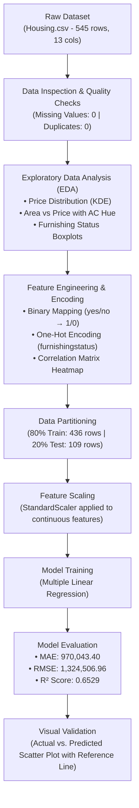

# Samsung Innovation Campus: Housing Price Prediction

[](https://www.python.org/)
[](https://jupyter.org/)
[](https://scikit-learn.org/)
[](https://pandas.pydata.org/)
[](https://numpy.org/)
[](LICENSE)

An end-to-end Machine Learning regression project developed as part of the **Samsung Innovation Campus (SIC)** program. This project implements an exploratory data analysis (EDA) pipeline, preprocessing and feature engineering workflow, and a multiple linear regression model to predict residential real estate prices based on spatial, structural, and amenity attributes.

---

## Table of Contents

- [Project Overview](#project-overview)
- [Workflow Architecture](#workflow-architecture)
- [Repository Structure](#repository-structure)
- [Dataset Summary](#dataset-summary)
  - [Feature Dictionary](#feature-dictionary)
  - [Data Quality Checks](#data-quality-checks)
- [Exploratory Data Analysis (EDA)](#exploratory-data-analysis-eda)
- [Data Preprocessing & Feature Engineering](#data-preprocessing--feature-engineering)
- [Model Training & Evaluation](#model-training--evaluation)
  - [Model Selection](#model-selection)
  - [Performance Metrics](#performance-metrics)
- [Key Insights](#key-insights)
- [Getting Started](#getting-started)
  - [Prerequisites](#prerequisites)
  - [Installation](#installation)
  - [Running the Notebook](#running-the-notebook)
- [Future Enhancements](#future-enhancements)
- [Author & Acknowledgments](#author--acknowledgments)

---

## Project Overview

Accurate property valuation is a core challenge in the real estate sector. Residential house prices depend on complex interactions between physical characteristics (such as surface area, bedroom count, and stories) and convenience features (such as air conditioning, parking spaces, and neighborhood desirability).

The primary goals of this project are:
1. **Explore & Understand**: Analyze the distribution of property prices and examine relationships between property attributes and market valuation.
2. **Preprocess & Encode**: Clean categorical indicators, handle multi-class attributes, and standardize numerical variables to ensure balanced gradient propagation.
3. **Model & Predict**: Train an Ordinary Least Squares (OLS) Multiple Linear Regression model on an 80/20 train-test split.
4. **Evaluate & Interpret**: Assess model fit against test data using Mean Absolute Error (MAE), Root Mean Squared Error (RMSE), and the Coefficient of Determination ($R^2$).

---

## Workflow Architecture



---

## Repository Structure

```text
Samsung-Innovation-Campus/
├── Housing.csv               # Raw dataset containing 545 real estate records
├── Housing_Assignment.ipynb  # End-to-end Jupyter Notebook (EDA, preprocessing, modeling)
├── requirements.txt          # Python dependencies required to run the project
└── README.md                 # Project documentation and analysis summary
```

---

## Dataset Summary

The dataset comprises **545 observations** of residential properties across **13 features** (1 target variable and 12 predictor variables).

### Feature Dictionary

| Feature Name | Type | Description | Values / Range |
| :--- | :--- | :--- | :--- |
| `price` | Numerical (Target) | Sale price of the house in local currency | 1,750,000 – 13,300,000 (Mean: ~4.77M) |
| `area` | Numerical | Total surface area of the property (sq. ft.) | 1,650 – 16,200 (Mean: 5,150.54) |
| `bedrooms` | Numerical | Total number of bedrooms | 1 – 6 |
| `bathrooms` | Numerical | Total number of bathrooms | 1 – 4 |
| `stories` | Numerical | Number of stories/floors in the building | 1 – 4 |
| `mainroad` | Categorical (Binary) | Whether the property connects to a main road | `yes`, `no` |
| `guestroom` | Categorical (Binary) | Presence of a dedicated guest room | `yes`, `no` |
| `basement` | Categorical (Binary) | Presence of a basement | `yes`, `no` |
| `hotwaterheating`| Categorical (Binary) | Availability of a hot water heating system | `yes`, `no` |
| `airconditioning`| Categorical (Binary) | Availability of central air conditioning | `yes`, `no` |
| `parking` | Numerical | Number of dedicated car parking spots | 0 – 3 |
| `prefarea` | Categorical (Binary) | Whether the house is located in a preferred area | `yes`, `no` |
| `furnishingstatus`| Categorical (Multi) | Furnishing condition of the property | `furnished`, `semi-furnished`, `unfurnished` |

### Data Quality Checks

- **Missing Values**: None (`df.isna().sum() == 0`).
- **Duplicate Rows**: None (`df.duplicated().sum() == 0`).
- **Data Types**: 6 integer columns, 7 string/object columns.

---

## Exploratory Data Analysis (EDA)

The notebook executes three primary visual investigations:

1. **Price Distribution Analysis**:
   - Visualized using `seaborn.histplot` with Kernel Density Estimation (KDE).
   - Shows a right-skewed price distribution with the median price around 4.34M and the majority of transactions occurring between 3.43M and 5.74M.
2. **Area vs. Price Stratified by Air Conditioning**:
   - Scatter plot showing strong positive correlation between lot area and sale price.
   - Houses equipped with air conditioning systematically cluster in higher valuation brackets across all area sizes.
3. **Furnishing Status Impact**:
   - Box plot comparison demonstrating that fully furnished homes command the highest median prices, followed by semi-furnished and unfurnished properties.

---

## Data Preprocessing & Feature Engineering

1. **Binary Encoding**:
   The columns `['mainroad', 'guestroom', 'basement', 'hotwaterheating', 'airconditioning', 'prefarea']` were mapped from `yes`/`no` strings to integer values `1`/`0`.
2. **Nominal Categorical Encoding**:
   `furnishingstatus` was converted using `pd.get_dummies(..., drop_first=True)`. The baseline category (`furnished`) was dropped to avoid multi-collinearity (dummy variable trap), producing:
   - `furnishingstatus_semi-furnished`
   - `furnishingstatus_unfurnished`
3. **Correlation Analysis**:
   - A correlation heatmap was computed on all numeric and encoded columns to inspect inter-feature relationships and collinearity before training.
4. **Train-Test Split**:
   - Dataset partitioned into training (80%, 436 samples) and test (20%, 109 samples) sets with fixed seed `random_state=42` to guarantee reproducibility.
5. **Feature Scaling**:
   - `StandardScaler` from scikit-learn was fit exclusively on continuous training features `['area', 'bedrooms', 'bathrooms', 'stories', 'parking']` and applied to transform both training and testing partitions, preventing data leakage.

---

## Model Training & Evaluation

### Model Selection
- **Algorithm**: Multiple Linear Regression (`sklearn.linear_model.LinearRegression`).
- **Formulation**:
  $$\hat{y} = \beta_0 + \sum_{i=1}^{p} \beta_i X_i$$

### Performance Metrics

Evaluated on the unseen test set (109 samples):

| Metric | Value | Interpretation |
| :--- | :--- | :--- |
| **Mean Absolute Error (MAE)** | **970,043.40** | On average, predictions deviate by ~970k from the actual house price. |
| **Root Mean Squared Error (RMSE)** | **1,324,506.96** | Penalizes larger error residuals; reflects standard deviation of residuals. |
| **Coefficient of Determination ($R^2$)** | **0.6529** | **65.29%** of the variance in house prices is explained by the model's features. |

### Prediction vs. Actuals Plot
The model's predictions were evaluated using a scatter plot comparing actual versus predicted values against a diagonal reference line ($y = x$). The model exhibits consistent tracking around the ideal fit line across mainstream price tiers, with slight underestimation on extreme luxury outliers (>10M).

---

## Key Insights

- **Living Area & Bathrooms**: Area and bathroom count demonstrate the strongest positive linear associations with property price.
- **Modern Amenities**: Air conditioning and preferred neighborhood status (`prefarea`) provide substantial price premiums.
- **Furnishing Factor**: Unfurnished status acts as a downward price modifier relative to furnished and semi-furnished homes.
- **Linear Assumptions**: The $R^2$ of ~0.65 demonstrates that baseline linear regression captures roughly two-thirds of the valuation variance, leaving room for non-linear modeling.

---

## Getting Started

### Prerequisites

- Python 3.8 or higher
- Jupyter Notebook or JupyterLab

### Installation

1. **Clone the repository**:
   ```bash
   git clone https://github.com/aritrachakraborty2909-hub/Samsung-Innovation-Campus.git
   cd Samsung-Innovation-Campus
   ```

2. **Create and activate a virtual environment (recommended)**:
   ```bash
   # On Windows
   python -m venv venv
   venv\Scripts\activate

   # On macOS/Linux
   python3 -m venv venv
   source venv/bin/activate
   ```

3. **Install dependencies**:
   ```bash
   pip install -r requirements.txt
   ```
   *(Alternatively: `pip install pandas numpy matplotlib seaborn scikit-learn jupyter`)*

### Running the Notebook

Launch Jupyter Notebook and open `Housing_Assignment.ipynb`:

```bash
jupyter notebook Housing_Assignment.ipynb
```

Execute cells sequentially to replicate the data cleaning, visualizations, model training, and performance metrics.

---

## Future Enhancements

- [ ] **Regularization**: Test Ridge (`L2`), Lasso (`L1`), and ElasticNet regression to control coefficient shrinkage and potential collinearity.
- [ ] **Non-Linear Models**: Benchmark tree-based algorithms (Random Forest Regressor, XGBoost, LightGBM) to capture non-linear relationships.
- [ ] **Log-Transformation**: Apply $\log(1 + y)$ transformation to target variable `price` to mitigate right-skewness and stabilize residual variance.
- [ ] **Hyperparameter Tuning & Cross-Validation**: Implement $k$-fold cross-validation (`GridSearchCV`) for robust generalization checks.
- [ ] **Interactive Deployment**: Build a lightweight web application (e.g., Streamlit) allowing users to enter custom house features and receive instant price estimates.

---

## Author & Acknowledgments

- **Author**: Aritra Chakraborty ([@aritrachakraborty2909-hub](https://github.com/aritrachakraborty2909-hub))
- **Program**: [Samsung Innovation Campus](https://www.samsung.com/in/microsite/sapnepadhai/samsung-innovation-campus/) (AI & Data Science Curriculum)

---

## License

This project is licensed under the [MIT License](LICENSE) — see the LICENSE file for details.
